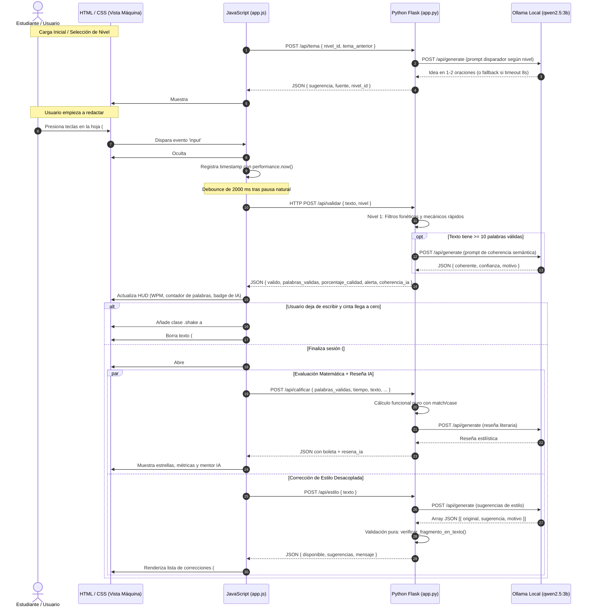

# 📑 Reporte de Avance, Arquitectura e Ingeniería de Código: "Escribe si puedes"

> **Materia:** Programación Funcional  
> **Carrera:** Ingeniería en Computación Inteligente — Universidad de Colima  
> **Semestre:** 3º Semestre — Grupo B (Agosto 2026 - Enero 2027)  
> **Estudiantes del Equipo:** Diego Guadalupe Torres Bravo y Christopher Emmanuel Jimenez Cuevas  
> **Archivo de Control y Estudio:** [`proyectopf/reporte_avance.md`](file:///c:/Users/diego/Desktop/Facultad%20ICI/Tercer%20Semestre/Programaci%C3%B3n%20Funcional/Proyecto/proyectopf/reporte_avance.md)  
> **Archivos del Sistema:** [`proyectopf/app.py`](file:///c:/Users/diego/Desktop/Facultad%20ICI/Tercer%20Semestre/Programaci%C3%B3n%20Funcional/Proyecto/proyectopf/app.py), [`proyectopf/static/index.html`](file:///c:/Users/diego/Desktop/Facultad%20ICI/Tercer%20Semestre/Programaci%C3%B3n%20Funcional/Proyecto/proyectopf/static/index.html), [`proyectopf/static/app.js`](file:///c:/Users/diego/Desktop/Facultad%20ICI/Tercer%20Semestre/Programaci%C3%B3n%20Funcional/Proyecto/proyectopf/static/app.js), [`proyectopf/static/style.css`](file:///c:/Users/diego/Desktop/Facultad%20ICI/Tercer%20Semestre/Programaci%C3%B3n%20Funcional/Proyecto/proyectopf/static/style.css)  
> **Propósito Pedagógico:** Explicar exhaustivamente la arquitectura, diseño sensorial, lógica funcional, fragmentos clave de código en cada lenguaje (Python, JavaScript, HTML, CSS), su funcionamiento interno y el flujo de comunicación fullstack entre cliente y servidor.

---

## 🎯 1. Visión y Propósito del Sistema

**"Escribe si puedes"** es una aplicación web interactiva y gamificada diseñada para combatir el bloqueo del escritor, la procrastinación, el perfeccionismo paralizante y la autoedición prematura. Su concepto se inspira en una **máquina de escribir mecánica retro** sujeta a seis mecánicas entrelazadas:

1. **Disparador Temático al Arrancar (Vence la Hoja en Blanco):**  
   Al abrir la aplicación o cambiar de nivel, una tarjeta no invasiva presenta una idea sugerente de 1–2 oraciones generada por IA según el nivel (Cotidiana en Nivel 1, Personaje/Situación en Nivel 2, Abstracta en Nivel 3) con botón de alternancia (*"Otro tema"*). Desaparece suavemente al teclear la primera letra sin bloquear ni iniciar el temporizador.
2. **Urgencia Controlada (Gamificación con Borrado Punitivo):**  
   Si el usuario interrumpe su tecleo por más tiempo del umbral de tolerancia de su nivel (de 2.5 a 7.5 segundos), la pantalla se satura de alerta de tinta roja y el contenido se borra por completo, forzando un estado de flujo continuo (*flow state*).
3. **Sostenibilidad Mental (Metodología Pomodoro con Pausas Seguras):**  
   El tiempo se organiza en bloques de concentración activa (5, 10 o 15 minutos) alternados con descansos protegidos (2 a 5 minutos) donde la regla de borrado punitivo se desactiva.
4. **Escudo Antifraude en Dos Niveles:**  
   - **Nivel 1 (Filtro Rápido en Python Puro, <1 ms):** Valida repeticiones mecánicas y estructura fonética/vocal.
   - **Nivel 2 (Análisis Semántico con Ollama `qwen2.5:3b`, 2–5 s):** Evalúa si el texto acumulado ($ \ge 10 $ palabras) posee coherencia lingüística global.
5. **Mentoría Creativa y Reseña Literaria:**  
   Al concluir o calificar la sesión, el modelo `qwen2.5:3b` emite una crítica constructiva sobre la atmósfera, virtudes estilísticas y sugerencias de mejora del texto producido.
6. **Corrección de Estilo Asistida por IA con Validación Anti-Alucinaciones:**  
   En el reporte final, un módulo desacoplado (`/api/estilo`) analiza repeticiones, frases redundantes y ortografía, mostrando hasta 3 sugerencias con fragmento original, alternativa y motivo. Una función pura valida que cada fragmento original citado exista verdaderamente en el texto del usuario antes de desplegarlo.

---

## 🗺️ 2. Mapa de Interacción Fullstack (¿Cómo interactúan los lenguajes?)

El sistema articula 4 tecnologías mediante una arquitectura cliente-servidor orientada a eventos y servicios REST:



---

## 🐍 3. Backend: Python Flask y Programación Funcional ([`app.py`](file:///c:/Users/diego/Desktop/Facultad%20ICI/Tercer%20Semestre/Programaci%C3%B3n%20Funcional/Proyecto/proyectopf/app.py))

### A. Modelado Inmutable (`NamedTuple`, `frozenset` y `tuple`)

```python
class NivelConfig(NamedTuple):
    id: int
    nombre: str
    descripcion: str
    tolerancia_inactividad_seg: float
    meta_palabras: int
    tiempo_pomodoro_min: int
    tiempo_descanso_min: int

class TemaSugerido(NamedTuple):
    nivel_id: int
    texto: str
    categoria: str

class SugerenciaEstilo(NamedTuple):
    original: str
    sugerencia: str
    motivo: str

VOCALES_VALIDAS: frozenset[str] = frozenset({'a', 'e', 'i', 'o', 'u', 'á', 'é', 'í', 'ó', 'ú', 'ü'})

# Catálogo inmutable de 18 temas de respaldo
TEMAS_PREDEFINIDOS: tuple[TemaSugerido, ...] = (
    TemaSugerido(1, "Describe con sumo detalle el primer sonido que escuchaste al despertar...", "Cotidiano"),
    TemaSugerido(2, "Un relojero veterano descubre que uno de los relojes de su taller retrocede cada medianoche...", "Situación"),
    TemaSugerido(3, "Si los recuerdos tuvieran peso físico y se acumularan en una habitación cerrada...", "Abstracto"),
    # ... 18 temas inmutables distribuidos por nivel
)
```

---

### B. Generación Pura de Disparadores Temáticos

```python
def obtener_temas_por_nivel(nivel_id: int) -> tuple[TemaSugerido, ...]:
    """Función pura que filtra la tupla inmutable de temas por el nivel solicitado."""
    temas = tuple(t for t in TEMAS_PREDEFINIDOS if t.nivel_id == nivel_id)
    return temas if temas else TEMAS_PREDEFINIDOS

def seleccionar_tema_fallback(nivel_id: int, tema_actual: str = "") -> str:
    """Selecciona un tema de respaldo garantizando que no se repita con el actual."""
    temas_disponibles = obtener_temas_por_nivel(nivel_id)
    candidatos = tuple(t.texto for t in temas_disponibles if t.texto != tema_actual)
    if not candidatos:
        candidatos = tuple(t.texto for t in temas_disponibles)
    return random.choice(candidatos) if candidatos else "Escribe libremente lo primero que llegue a tu mente."

def construir_prompt_tema(nivel_id: int) -> str:
    """Función pura que adapta el enfoque temático según la dificultad."""
    match nivel_id:
        case 1: enfoque = "un disparador sobre algo COTIDIANO o sensorial (máximo 2 oraciones)"
        case 2: enfoque = "una premisa sobre un PERSONAJE o SITUACIÓN con misterio (máximo 2 oraciones)"
        case 3: enfoque = "un tema ABSTRACTO, filosófico o poético (máximo 2 oraciones profundas)"
        case _: enfoque = "una idea creativa e inspiradora para redactar (máximo 2 oraciones)"
    return f"Eres un mentor de escritura creativa. Genera {enfoque} en español..."
```

---

### C. Validación Pura Anti-Alucinaciones en Corrección de Estilo

Los modelos de lenguaje tienden a veces a parafrasear o inventar citas cuando se les solicita señalar fragmentos originales. Para garantizar la integridad pedagógica:

```python
def normalizar_para_busqueda(texto: str) -> str:
    """Función pura que normaliza espacios para comparar fragmentos."""
    return re.sub(r'\s+', ' ', texto.strip().lower())

def verificar_fragmento_en_texto(fragmento: str, texto_completo: str) -> bool:
    """
    Función pura que valida estrictamente si el fragmento original citado por la IA
    existe de forma real en el texto del usuario.
    """
    if not fragmento or not texto_completo:
        return False
    frag_norm = normalizar_para_busqueda(fragmento)
    texto_norm = normalizar_para_busqueda(texto_completo)

    if frag_norm in texto_norm:
        return True

    # Tolerancia a signos de puntuación periféricos
    frag_sin_signos = re.sub(r'^[.,;:¡!¿?()"\']+|[.,;:¡!¿?()"\']+$', '', frag_norm)
    return len(frag_sin_signos) >= 3 and frag_sin_signos in texto_norm

def filtrar_sugerencias_estilo_validas(
    sugerencias_crudas: tuple[dict, ...],
    texto_usuario: str,
    max_items: int = 3
) -> tuple[SugerenciaEstilo, ...]:
    """Descarta citas alucinadas y devuelve hasta 3 sugerencias con citas verificadas."""
    validas: list[SugerenciaEstilo] = []
    for item in sugerencias_crudas:
        orig = str(item.get("original", "")).strip()
        sug = str(item.get("sugerencia", "")).strip()
        mot = str(item.get("motivo", "")).strip()

        if orig and sug and mot and verificar_fragmento_en_texto(orig, texto_usuario):
            validas.append(SugerenciaEstilo(original=orig, sugerencia=sug, motivo=mot))
            if len(validas) >= max_items:
                break
    return tuple(validas)
```

---

### D. Endpoints REST Desacoplados

- `GET /api/niveles`: Consulta la tupla inmutable `CONFIGURACION_NIVELES`.
- `POST /api/validar`: Pipeline antifraude en 2 etapas (filtros por palabra + Ollama).
- `POST /api/tema`: Genera ideas disparadoras con Qwen 2.5 3B (timeout 8s con degradación a catálogo inmutable).
- `POST /api/calificar`: Computa calificación matemática pura (`match...case`) y reseña literaria.
- `POST /api/estilo`: Analiza estilo y ortografía de forma asíncrona sin bloquear ni alterar la puntuación.

---

## ⚡ 4. Frontend: Vanilla JavaScript ([`static/app.js`](file:///c:/Users/diego/Desktop/Facultad%20ICI/Tercer%20Semestre/Programaci%C3%B3n%20Funcional/Proyecto/proyectopf/static/app.js))

### A. Gestión de Temas Sugeridos

```javascript
async function solicitarTemaSugerido(forzarOtro = false) {
  if (AppState.cargandoTema) return;
  AppState.cargandoTema = true;
  DOM.btnOtroTema.disabled = true;
  DOM.topicText.textContent = 'Buscando una idea inspiradora…';

  const nivelId = AppState.nivelSeleccionado ? AppState.nivelSeleccionado.id : 1;
  const temaAnterior = forzarOtro ? AppState.temaActual : '';

  try {
    const res = await fetch('/api/tema', {
      method: 'POST',
      headers: { 'Content-Type': 'application/json' },
      body: JSON.stringify({ nivel_id: nivelId, tema_anterior: temaAnterior })
    });
    const data = await res.json();
    AppState.temaActual = data.sugerencia || '';
    DOM.topicText.textContent = AppState.temaActual;
  } catch (err) {
    // Fallback local
  } finally {
    AppState.cargandoTema = false;
    DOM.btnOtroTema.disabled = false;
    actualizarVisibilidadTarjetaTema();
  }
}

function actualizarVisibilidadTarjetaTema() {
  if (!DOM.topicCard) return;
  if (DOM.writingArea && DOM.writingArea.value.trim().length > 0) {
    DOM.topicCard.classList.add('hidden');
  } else {
    DOM.topicCard.classList.remove('hidden');
  }
}
```

---

### B. Corrección de Estilo Asíncrona en el Reporte Final

```javascript
async function mostrarReporteCalificacion() {
  const textoEscrito = DOM.writingArea.value;

  // 1. Iniciar inmediatamente la consulta de estilo en paralelo (no bloquea el modal)
  solicitarCorreccionEstilo(textoEscrito);

  // 2. Obtener calificación matemática y reseña literaria
  const evaluacion = await solicitarCalificacionFinal();

  DOM.summaryRank.textContent = evaluacion.rango;
  DOM.starsDisplay.textContent = '★'.repeat(evaluacion.estrellas) + '☆'.repeat(5 - evaluacion.estrellas);
  DOM.finalScoreVal.textContent = `${evaluacion.puntaje_total} / 100`;
  DOM.modalCalificacion.style.display = 'flex';
}
```

---

## 🎨 5. Frontend: Estructura y Estilos ([`index.html`](file:///c:/Users/diego/Desktop/Facultad%20ICI/Tercer%20Semestre/Programaci%C3%B3n%20Funcional/Proyecto/proyectopf/static/index.html) y [`style.css`](file:///c:/Users/diego/Desktop/Facultad%20ICI/Tercer%20Semestre/Programaci%C3%B3n%20Funcional/Proyecto/proyectopf/static/style.css))

- **Tarjeta de Tema (`.topic-card`):** Colocada en la cabecera de la hoja pautada con borde discontinuo `1px dashed var(--paper-shadow)`, acento de latón `var(--brass-dark)` y botón físico `.btn-another-topic`. Transición suave de colapso con `.hidden`.
- **Corrección de Estilo (`.style-review-card`):** Tarjeta con efecto de nota adhesiva mecanografiada, spinner animado `.typewriter-spinner` y badges `.style-badge-tag.original` y `.style-badge-tag.suggestion`.
- **Compatibilidad de 6 Temas:** Diseñado exclusivamente con variables CSS (`var(--paper)`, `var(--ink)`, `var(--brass-light)`, `var(--ribbon-red)`), adaptándose a `olivetti`, `tinta`, `royal`, `burdeos`, `escritorio` y `cafe`.

---

## 📊 6. Matriz de Componentes y Responsabilidades Técnicas

| Archivo | Lenguaje | Rol en la Arquitectura | Conceptos Técnicos y Funcionales Aplicados |
| :--- | :---: | :--- | :--- |
| [`proyectopf/app.py`](file:///c:/Users/diego/Desktop/Facultad%20ICI/Tercer%20Semestre/Programaci%C3%B3n%20Funcional/Proyecto/proyectopf/app.py) | **Python 3.10+** | API REST, Motor Antifraude, Temas y Estilo | Inmutabilidad (`NamedTuple`, `frozenset`, `tuple`), funciones puras de filtrado anti-alucinaciones, catálogo de 18 temas predefinidos, *Pattern Matching* (`match...case`), integración HTTP con Ollama local (`qwen2.5:3b`), CORS manual. |
| [`static/index.html`](file:///c:/Users/diego/Desktop/Facultad%20ICI/Tercer%20Semestre/Programaci%C3%B3n%20Funcional/Proyecto/proyectopf/static/index.html) | **HTML5** | Estructura Semántica del Lienzo | Tarjeta `#topicCard` en el lienzo de escritura, sección `#styleReviewCard` con spinner y lista de correcciones en el modal de calificación. |
| [`static/style.css`](file:///c:/Users/diego/Desktop/Facultad%20ICI/Tercer%20Semestre/Programaci%C3%B3n%20Funcional/Proyecto/proyectopf/static/style.css) | **CSS3** | Estética Vintage y Respuesta Visual | Variables temáticas para los 6 esquemas de color, animación `.topic-card.hidden`, spinner de máquina `@keyframes spin`, badges semánticos para citas originales y sugerencias. |
| [`static/app.js`](file:///c:/Users/diego/Desktop/Facultad%20ICI/Tercer%20Semestre/Programaci%C3%B3n%20Funcional/Proyecto/proyectopf/static/app.js) | **JavaScript ES6+** | Controlador de Estados y Sincronización | Estado global reactivo (`AppState`), consumo asíncrono no bloqueante de `/api/tema` y `/api/estilo`, escape seguro de HTML y ocultamiento reactivo de sugerencias al teclear. |
| [`reporte_avance.md`](file:///c:/Users/diego/Desktop/Facultad%20ICI/Tercer%20Semestre/Programaci%C3%B3n%20Funcional/Proyecto/proyectopf/reporte_avance.md) | **Markdown** | Documentación de Aprendizaje y Estudio | Guía técnica completa, diagramas Mermaid actualizados y análisis conceptual para Diego y Christopher. |

---

## 🎓 7. Conclusiones y Guía de Estudio para los Estudiantes

1. **Aislamiento de tareas de cómputo intensivo:**  
   La separación de endpoints (`/api/calificar` vs `/api/estilo`) ilustra cómo el diseño asíncrono previene interfaces congeladas, permitiendo que la respuesta inmediata viaje al usuario mientras los procesos de inferencia de lenguaje continúan en segundo plano.
2. **Validación funcional pura frente a incertidumbre de IA:**  
   Dado que los LLMs pueden alucinar citas que el usuario nunca escribió, la función pura `verificar_fragmento_en_texto` actúa como un árbitro matemático determinista que garantiza la verdad de los datos antes de presentarlos en la vista.
3. **Inmutabilidad y robustez:**  
   El uso de tuplas inmutables (`TEMAS_PREDEFINIDOS`) y `NamedTuple` asegura que el estado del servidor sea completamente seguro ante consultas concurrentes.
